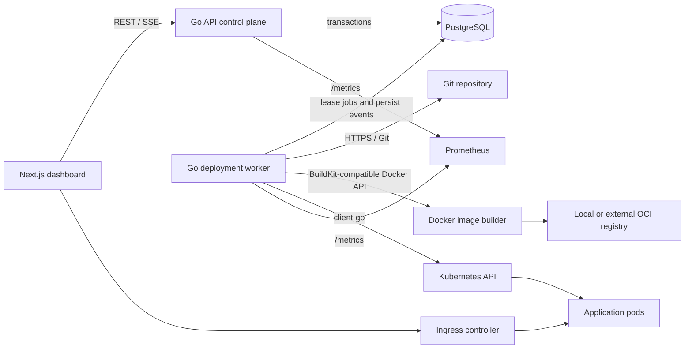
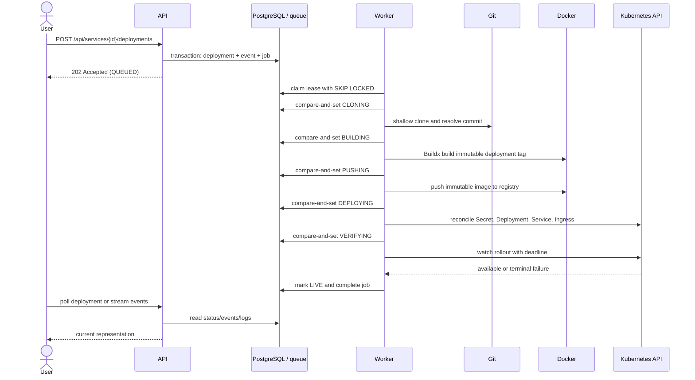
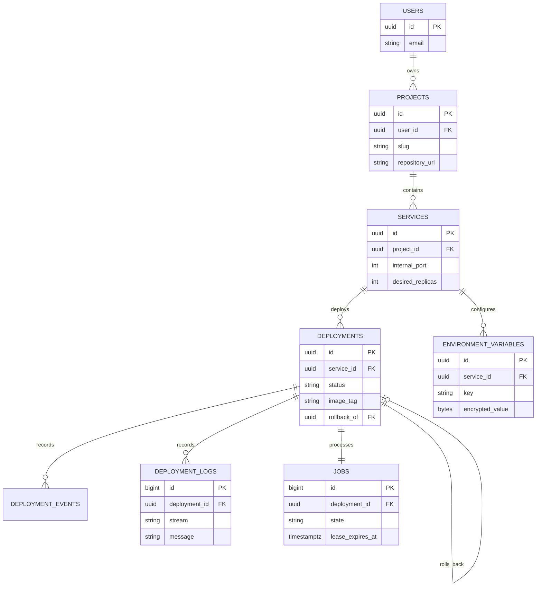

# Forge Architecture

Status: implemented local architecture. Environment-dependent validation results and intentional gaps are tracked in [MILESTONES.md](MILESTONES.md).

## System shape

Forge is a modular control plane with two Go processes and one browser application. PostgreSQL is both the source of truth and the durable job queue. A worker turns an immutable deployment record into an image and reconciles Kubernetes resources. Deployed applications form the data plane and do not call back into Forge to serve traffic.

## Control plane

The control plane consists of the API, worker, dashboard, and PostgreSQL. The API owns validation and user intent; the worker owns long-running, failure-prone reconciliation. PostgreSQL stores projects, services, configuration metadata, deployments, append-only events and logs, and leased jobs. This creates explicit transaction boundaries and makes deployment state inspectable after process failures.

The authentication mode injects one configured local-development user. Repository/store methods still take an owner ID, and handlers enforce ownership so GitHub OAuth can replace the authenticator without rewriting domain logic. This is an extensibility boundary, not a production authentication claim.

The health monitor is part of the worker process but independent of deployment job slots. It periodically observes the latest successful workload for each service, persists `RUNNING`, `DEGRADED`, or `UNHEALTHY`, and garbage-collects Forge-labelled resources whose service no longer exists.

## Data plane

The data plane consists of namespaces, Deployments, Services, Secrets, and Ingresses created for user workloads. Resources carry `app.kubernetes.io/managed-by=forge` and stable Forge identifiers. Kubernetes owns pod restart and rolling-update mechanics; Forge observes rollouts instead of implementing a competing scheduler.

## Deployment lifecycle

Any nonterminal stage can transition to `FAILED`; `CANCELLED` is modeled but no cancellation endpoint is exposed. A worker records contextual output throughout the operation. Each state transition and its event insert share a transaction. The exact allowed edges live in `internal/domain/deployment.go`.

## Database model

Foreign keys protect ownership relationships, checks constrain enums and resource values, and indexes cover owner listings, service history, event/log pagination, health scans, and available-job claims. Secret ciphertext and nonce are stored beside public metadata but are selected only by the worker's internal deployment path. Webhook deliveries form a separate deduplication ledger keyed by GitHub's delivery ID.

## Consistency boundaries

- Project/service/environment writes are strongly consistent after the API transaction returns.
- Deployment intent, its initial event, and its unique queue job commit atomically.
- Concurrent enqueue transactions for one service take a short transaction-scoped lock before allocating the job identity, giving FIFO eligibility a durable order.
- Status plus the event describing that transition commit atomically under a row lock.
- External effects are eventually consistent with PostgreSQL. A worker can create a Kubernetes resource and crash before recording progress; stable names and state re-read make the next attempt reconcile rather than duplicate it.
- Job ownership is a lease, not a permanent lock. FIFO eligibility and a session-level advisory lock serialize deployments that target the same service while allowing different services to run concurrently.
- Health is intentionally stale by at most the configured monitor interval plus check time.

## Job queue

Workers claim eligible rows with `SELECT ... FOR UPDATE SKIP LOCKED`, set a per-process/per-slot lease owner and expiry, then commit before doing external work. Eligibility blocks a newer job while an older job for the same service is available or running; different services remain parallel. A heartbeat extends active leases, and completion/retry use owner compare-and-set checks. If a heartbeat fails, that worker cancels work and performs no stale finalization because it can no longer prove ownership. An expired lease is reclaimed as the same logical attempt, including at the retry limit, so a final-attempt crash cannot strand a running row. Transient failures use capped exponential backoff with jitter; deterministic validation/build-context and rollout errors fail immediately. A service-scoped advisory lock fences an expired old owner that may still be executing; a connection is destroyed rather than returned to the pool if explicit unlock fails. Because each active lock pins one PostgreSQL session, the worker pool is sized from deployment concurrency with separate headroom for heartbeats, events, and logs. Delivery is deliberately at least once.

FIFO ordering intentionally creates head-of-line blocking within one service. A production scheduler would add explicit cancellation/supersession policy rather than letting a newer deployment silently overtake an older retry and later be overwritten by it.

PostgreSQL is a deliberate first-stage choice: deployment creation plus enqueueing is atomic, operational state is queryable with one datastore, and expected portfolio/local throughput is modest. At sustained high queue volume, the job boundary can move to a broker or event stream while PostgreSQL remains authoritative.

## Kubernetes integration

Forge uses the official Go client rather than templating shell commands. One namespace is used by default, with service-level stable names. It reconciles:

- a Secret containing current environment values;
- a Deployment using an immutable image tag, numeric unprivileged UID/GID, rolling updates, probes, resources, and Forge labels;
- a ClusterIP Service targeting the configured container port;
- a networking/v1 Ingress routing `<service>-<project>-<service-id-prefix>.<base-domain>` (or `<project>.<base-domain>` for the exact primary `web` service), with overlong labels deterministically shortened. The stable suffix prevents friendly names that normalize to the same DNS label from colliding.

Readiness waits are time-bounded and report rollout conditions, image pull failures, and representative pod termination reasons. Kubernetes readiness probes are Forge's application health gate; an ingress controller may publish the already-reconciled route a moment later, so the black-box E2E check waits separately for external route convergence. Reconciliation is safe to repeat for the same deployment. A real kind integration test verifies resource creation, image pull, readiness, route convergence, runtime-log access, and cleanup through the official client.

## Networking

ingress-nginx terminates local HTTP and routes by `Host`. The default base domain is `localhost`, which resolves subdomains to loopback in modern environments; the development guide includes a direct `Host`-header alternative. The kind node maps host ports 80/443. TLS, DNS ownership verification, and arbitrary custom domains are outside the local scope.

## Failure handling

- API/database errors return a stable JSON error envelope and an `X-Request-ID` header.
- Invalid repository URLs, refs, Dockerfiles, ports, resources, and environment keys fail before dangerous operations.
- Clone/context validation, build, push/reconciliation, rollout, and health verification have deadlines.
- Worker leases recover abandoned jobs; retry classification avoids rebuilding permanent failures indefinitely.
- Stable Kubernetes names make retry reconciliation idempotent.
- Logs and events are persisted incrementally with bounded record and stage sizes; configured secret plaintext is redacted from captured runtime output.
- A failed new rollout retains immutable history. Rollback creates a new record using an earlier successful image.
- Periodic garbage collection removes orphaned Kubernetes resource sets after database deletion.

## Security boundary

The browser, API payloads, Git webhook payloads, repositories, Dockerfiles, images, application output, and application traffic are untrusted. The operator, Forge configuration, PostgreSQL, image registry, and Kubernetes API are trusted. Local Docker builds can execute attacker-controlled build steps with daemon-equivalent impact on the build host; this is the dominant non-production limitation. The complete threat model, current controls, RBAC reference, and limitations are in [SECURITY.md](SECURITY.md).

## Important engineering decisions

- **Go:** the control plane spends most of its time coordinating concurrent I/O and benefits from static binaries, explicit cancellation, and mature Docker/Kubernetes clients. A shared module keeps domain rules identical in API and worker without creating premature services.
- **PostgreSQL:** Forge needs relational ownership, transactional state transitions, ordered event history, and durable jobs. One consistent store is more useful here than adding Redis solely for a low-volume queue.
- **Asynchronous jobs:** cloning, builds, and rollouts last far beyond an HTTP request and must survive client disconnects and API restarts.
- **Kubernetes:** the point of Forge is to demonstrate real workload reconciliation, health, rolling updates, and routing. Forge delegates pod scheduling and restart semantics instead of recreating them.
- **Docker/Buildx:** Dockerfiles provide a precise initial build contract, BuildKit cache, and portable OCI artifacts. Automatic detection is deferred until the explicit path is reliable; daemon access is isolated to the worker process.
- **REST:** resources and transitions map cleanly to HTTP, are easy to inspect in interviews and scripts, and do not justify GraphQL's schema/runtime cost.
- **Polling plus bounded SSE:** polling is resilient and sufficient for deployment state. SSE adds one-way event/log progress without WebSocket protocol complexity and uses short reconnectable sessions for predictable shutdown.
- **Immutable history and image tags:** images use the deployment UUID, not a mutable branch tag. This gives every attempt an unambiguous artifact and makes rollback auditable even when the same commit is rebuilt.
- **Rolling updates:** Forge configures Kubernetes rolling strategy and readiness gates, keeping traffic on ready replicas during routine updates without implementing its own traffic switcher.

## Scale evolution

At roughly 10 deployments/day, one API, one PostgreSQL instance, and a small concurrent worker are sufficient. At 10,000/day, split builder and deployer pools, use a managed registry and object log storage, add API replicas, read replicas, queue partitioning, remote build cache, and per-tenant rate limits. At 1,000,000/day, use a durable event stream, regional control planes, a dedicated sandboxed build fleet, multi-cluster placement, globally replicated metadata with explicit ownership, hierarchical scheduling, tenant isolation, and a scalable telemetry pipeline. Those systems are intentionally not simulated in this repository.
